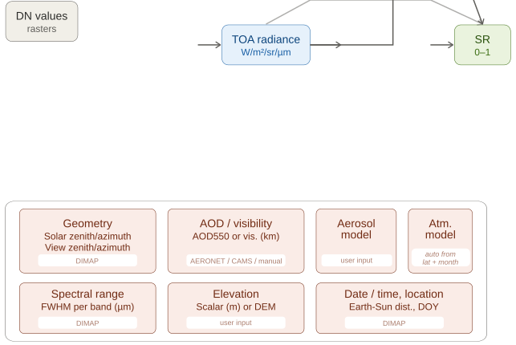

## DESCRIPTION

> [!WARNING]  
> This addon is work in progress (consider it a alpha version), so use at your own risk. If you find any bug,
> of if you have suggestions for improvements, please file a bug report.

*i.in.pneo* imports Pléiades-NEO 6-band GeoTIFF imagery into
GRASS GIS and performs radiometric preprocessing. Depending on the
available metadata and atmospheric data, the module automatically
determines the highest processing level it can achieve

1. **Full atmospheric correction** (DIMAP + atmospheric data +
   **icnd_basename**): Computes TOA radiance and runs *i.atcorr*
   (6S) for physically-based atmospheric correction.
2. **Parameter files for manual correction** (DIMAP + atmospheric data +
   **icnd_basename** + **-a** flag): Computes TOA radiance and DOS1
   reflectance, writes *i.atcorr* parameter files but does not run
   *i.atcorr*. The user can run *i.atcorr* manually afterwards.
3. **DOS1 approximate surface reflectance** (DIMAP, no atmospheric
   data or no **icnd_basename**): Computes TOA radiance and applies
   the Dark Object Subtraction (DOS1) method for approximate
   atmospheric correction.
4. **Radiance only** (no DIMAP): Converts DN values to TOA radiance
   using the Airbus convention (L = DN / GAIN + BIAS). This is the
   only option when DIMAP metadata is not available.

The processing pipeline is illustrated in the figure below. Raw DN values are divided by GAIN (Airbus convention) to produce TOA radiance, which is then fed into i.atcorr (6S radiative transfer model) to produce surface reflectance as a 0–1 fraction. The dashed line shows the DOS1 alternative path that skips the full radiative transfer when no atmospheric data is available. The upper box shows the five inputs that i.atcorr needs for the correction: AOD or visibility (from AERONET, CAMS, or manual), the aerosol model type, atmospheric model, viewing/solar geometry, and terrain elevation.



The module imports the GeoTIFF using *r.in.gdal* with the **-rk** flags
(clip to current region, use numeric band names), renames the bands
to clean underscore-separated names, and adjusts the computational
region to the intersection of the current region and the imported
image extent using *RegionManager*.

### Radiance conversion

Pléiades-NEO uses the Airbus convention:

```
L = DN / GAIN + BIAS
```

where L is TOA radiance in W/m²/sr/µm. The GAIN and BIAS (or
OFFSET) values are read from the NSO metadata XML file.

### DOS1 surface reflectance

The DOS1 (Dark Object Subtraction, method 1) correction estimates
path radiance from the darkest pixel in each band and removes it.
It requires DIMAP metadata for sun elevation and solar irradiance
(ESUN) values. DOS1 provides approximate surface reflectance
suitable for computing vegetation indices and basic scene comparison,
but it does not account for atmospheric transmittance, diffuse
irradiance, or adjacency effects.

### Atmospheric correction with i.atcorr

When atmospheric data (AERONET, CAMS, visibility, or AOD) is
available together with DIMAP metadata, the module generates *i.atcorr*
parameter files and runs *i.atcorr* for full 6S-based
atmospheric correction. The **range** parameter for *i.atcorr* is
automatically computed from the radiance map's value range. The
output rescale range can be controlled with the **rescale** parameter.

If an **elevation_map** raster is provided, it is passed to
*i.atcorr* for spatially variable atmospheric correction that
accounts for terrain elevation differences across the scene. This
is particularly relevant for scenes with significant topographic
relief. Without an elevation map, the scalar **elevation** value
(default 0 m) is used, assuming a flat surface. Note that using
a continuous elevation map increases *i.atcorr* computation time
considerably; using a categorized (integer) elevation map is
recommended for performance (see *i.atcorr* documentation).

### Atmospheric model auto-detection

When **atmospheric_model** is set to `auto` (the default), the 6S
atmospheric model is derived from the scene center latitude and
acquisition month:

- Tropical (1): latitude within 23.5° of equator
- Midlatitude summer (2) / winter (3): latitude 23.5°–66.5°
- Subarctic summer (4) / winter (5): latitude > 66.5°

The warm season is April–September in the Northern Hemisphere
and October–March in the Southern Hemisphere.

### Aerosol optical depth sources

The **aod_source** parameter controls how aerosol information is
obtained for the *i.atcorr* parameter files. The `auto` option
tries sources in this order: manual AOD value, local AERONET file,
CAMS NetCDF file, AERONET web service, manual visibility, and
finally falls back to no aerosol data.

#### AERONET

AERONET (AErosol RObotic NETwork) provides ground-based AOD
measurements. The module supports both local AERONET data files
(**aeronet_file**) and web retrieval from the AERONET data service.
For web retrieval, the nearest station to the scene center is
automatically selected, or a specific station can be chosen with
**aeronet_station**. The module selects the observation closest in
time to the scene acquisition within the configured time window.

#### CAMS

CAMS (Copernicus Atmosphere Monitoring Service) provides global
gridded atmospheric composition data. The module reads a
pre-downloaded CAMS NetCDF file (**cams_file**), finds the time step
closest to the scene acquisition, and computes the spatial mean of
AOD at 550nm over the analysis region. This requires the Python
package *netCDF4*.

### Intermediate radiance maps

By default, intermediate radiance maps are removed after processing
to save disk space (Pléiades-NEO 30cm scenes can be very large). Use
the **-k** flag to keep them. When no DIMAP metadata is provided
(processing level 4), radiance maps are the final product and are
always kept regardless of the **-k** flag.

## NOTES

This tool was developed to import and process Pléiades-NEO scenes available from the Satellietdataportaal, provided by the Netherlands Space Agency (NLSA). The portal offers free access to satellite imagery of the Netherlands for Dutch citizens. For further details on user licences and usage rights, please refer to the web portal.

## EXAMPLES

### Basic import with full atmospheric correction

Import a Pléiades-NEO scene with DIMAP metadata and AERONET-based
atmospheric correction:

```sh
i.pneo.import input=20240502_PNEO03_RGBNED.tif \
  nso_metadata=20240502_PNEO03_RGBNED.xml \
  dimap=DIM_PNEO3_202405021108320.XML \
  icnd_basename=/tmp/pneo_icnd \
  aerosol_model=3 \
  elevation_map=dem \
  rescale=0,1
```

### Import with DOS1 only (no atmospheric data)

When no atmospheric data source is available, DOS1 approximate
surface reflectance is computed automatically:

```sh
i.pneo.import input=20240502_PNEO03_RGBNED.tif \
  nso_metadata=20240502_PNEO03_RGBNED.xml \
  dimap=DIM_PNEO3_202405021108320.XML
```

### Import with CAMS atmospheric data

Use a pre-downloaded CAMS NetCDF file for AOD:

```sh
i.pneo.import input=20240502_PNEO03_RGBNED.tif \
  nso_metadata=20240502_PNEO03_RGBNED.xml \
  dimap=DIM_PNEO3_202405021108320.XML \
  icnd_basename=/tmp/pneo_icnd \
  aod_source=cams \
  cams_file=cams_aod_20240502.nc \
  aerosol_model=3
```

### Generate parameter files only (skip i.atcorr)

Use the **-a** flag to create *i.atcorr* parameter files without
running i.atcorr, allowing manual correction later:

```sh
i.pneo.import input=20240502_PNEO03_RGBNED.tif \
  nso_metadata=20240502_PNEO03_RGBNED.xml \
  dimap=DIM_PNEO3_202405021108320.XML \
  icnd_basename=/tmp/pneo_icnd \
  aod_source=aeronet_web \
  aerosol_model=3 -a
```

### Keep intermediate radiance maps

```sh
i.pneo.import input=20240502_PNEO03_RGBNED.tif \
  nso_metadata=20240502_PNEO03_RGBNED.xml \
  dimap=DIM_PNEO3_202405021108320.XML -k
```

### Radiance only (no DIMAP)

Without DIMAP metadata, only radiance maps are produced:

```sh
i.pneo.import input=20240502_PNEO03_RGBNED.tif \
  nso_metadata=20240502_PNEO03_RGBNED.xml
```

## REFERENCES

- NSO Satellietdataportaal:
  <https://www.satellietdataportaal.nl>
- AERONET: <https://aeronet.gsfc.nasa.gov>
- CAMS: <https://atmosphere.copernicus.eu>

## SEE ALSO

*[i.atcorr](i.atcorr.md) for atmospheric correction using 6S,
[r.in.gdal](r.in.gdal.md) for raster import,
[i.landsat.toar](https://grass.osgeo.org/grass-stable/manuals/addons/i.landsat.toar.html)
for Landsat DN to radiance/reflectance conversion,
[i.sentinel.preproc](https://grass.osgeo.org/grass-stable/manuals/addons/i.sentinel.preproc.html)
for Sentinel-2 preprocessing*

## AUTHOR

[Paulo van Breugel](https://ecodiv.earth)

<a href="https://www.has.nl/en/research/professorships/innovative-bio-monitoring-professorship/"></a> <a href="https://www.has.nl/en/research/professorships/climate-robust-landscapes-professorship/"></a> <a href="https://www.combined-project.eu/"></a> <a href="https://savethetiger.nl/"></a>