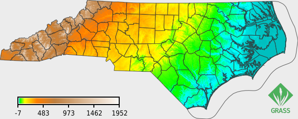
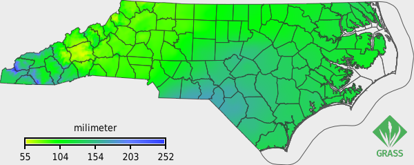
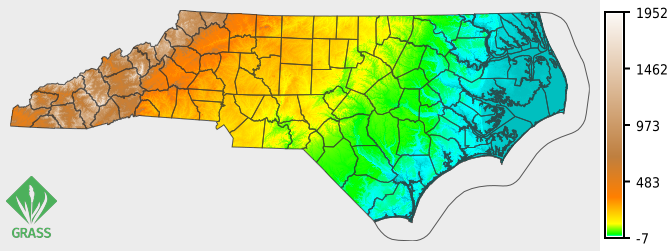
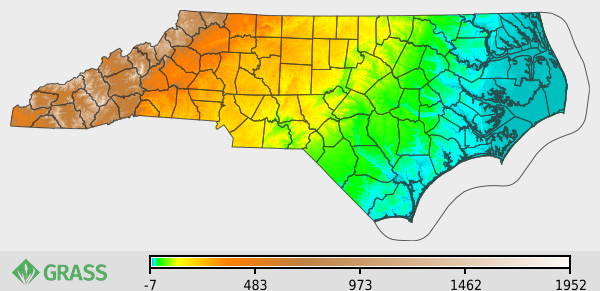
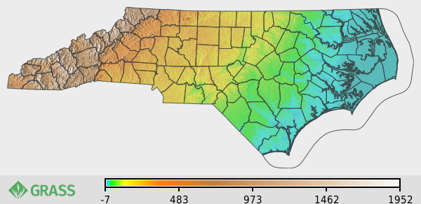

## NAME

_**m.printmap**_ - Composite raster, vector, legend and label layers into a PNG with per-layer opacity.


## Flags and parameters

### Flags:

* **\--overwrite**: Allow output files to overwrite existing files
* **\--help**: Print usage summary
* **\--verbose**: Verbose module output
* **\--quiet**: Quiet module output
* **\--ui**: Force launching GUI dialog

### Parameters:

* **spec**\=_name_: Layer spec file (existing) - Existing layer specification file to read or update
* **new\_spec**\=_name_: Layer spec file (new) - New layer specification file to create
* **operation**\=_string_ **\[required\]**: Action to perform on the spec file (update = change options of an existing layer; settings = set template settings) - Options: _add, replace, update, render, list, delete, settings_ - Default: _add_
* **type**\=_string_: Layer type (required for operation=add and operation=replace) - Options: _solid, raster, vector, labels, legend\_raster, legend\_vector, barscale, grid, image_
* **position**\=_string_: 1-based layer index; 0 = at the end (append/last layer) - Default: _0_
* **opacity**\=_float_: Layer opacity at compositing (0 = invisible, 1 = fully opaque) - Options: _0.0-1.0_ - Default: _1.0_
* **background**\=_name_: Image background color- Background color of the output image, i.e. the outer canvas (operation=render) - Default: _none_
* **output**\=_name_: Output PNG file- 
* **width**\=_integer_: Total output width in pixels (default 1200; quick pixel-based output)
* **figure\_width**\=_float_: Figure width in cm (physical output; needs dpi)
* **figure\_height**\=_float_: Figure height in cm (physical output; needs dpi)
* **dpi**\=_integer_: Resolution in dpi: sizes point-based fonts and line widths (both modes) and the figure in physical mode - Default: _96_
* **margin**\=_integer_: Margin in pixels around the map, filled by the solid layer (operation=render) - Default: _0_
* **font**\=_string_: Global render font - Default: _DejaVuSansCondensed_
* **fontsize**\=_float_: Base font size in points; per-element sizes are ratios of this - Default: _12_
* **solid\_color**\=_name_: Color - Fill color for a solid layer - Default: _white_
* **raster**\=_name_: Raster map to display
* **values**\=_string_: List of raster values to display (others transparent)
* **vector**\=_name_: Name of input vector map - Vector map to display
* **display\_type**\=_string_ - Vector feature type (default: auto-detected from the map, else area) - Options: _area, line, boundary, point, centroid_
* **color**\=_name_: Color - Vector line color - Default: _black_
* **fill\_color**\=_name_: Color - Vector fill color - Default: _none_
* **line\_width**\=_float_: Vector line width in points (1 pt = 1 px at 96 dpi)
* **cats**\=_range_: Category values - Category values to display
* **where**\=_sql\_query_: WHERE conditions of SQL statement without 'where' keyword - WHERE condition of SQL statement to select features
* **icon**\=_string_: Point/centroid symbol (e.g. basic/circle)
* **size**\=_float_: Point/centroid symbol size in points (1 pt = 1 px at 96 dpi)
* **labels**\=_name_: Name of input vector map - Vector map to label
* **label\_type**\=_string_: Feature type to label (default: auto-detected from the map, else area) - Options: _area, line, boundary, point, centroid_
* **attribute\_column**\=_name_: Attribute column to label with
* **label\_font\_scale**\=_float_: Label text size as a ratio of the base font size (default 1)
* **label\_color**\=_name_: Color - Label text color - Default: _black_
* **label\_font**\=_string_: Label font
* **xref**\=_string_: Label horizontal reference - Options: _left, center, right_
* **label\_cats**\=_range_: Category values - Category values to label
* **label\_where**\=_sql\_query_: WHERE conditions of SQL statement without 'where' keyword - WHERE condition of SQL statement to select features to label
* **legend\_raster\_map**\=_name_: Raster map the legend describes
* **legend\_raster\_title**\=_string_: Legend title
* **legend\_raster\_at**\=_float\[,float,...\]_: Placement as bottom,top,left,right (percent of the map; \<0 or \>100 places it outside the map)
* **legend\_raster\_font\_scale**\=_float_: Legend label size as a ratio of the base font size (default 1)
* **legend\_raster\_title\_scale**\=_float_: Legend title size as a ratio of the base font size (default 1)
* **legend\_raster\_digits**\=_integer_: Number of digits after the decimal point
* **legend\_raster\_flags**\=_string\[,string,...\]_: Flags passed to d.legend - Options: _v, c, n, f, l, t, s, d_
* **legend\_raster\_labelnum**\=_integer_: Number of labels for a smooth gradient legend
* **legend\_raster\_label\_values**\=_string_: Specific values to label in the legend
* **legend\_raster\_use**\=_string_: List of raster values to draw in the legend
* **legend\_raster\_border\_color**\=_name_: Color - Legend border color - 
Default: _none_
* **legend\_raster\_bgcolor**\=_name_: Color - Legend box background color - Default: _none_
* **legend\_vector\_map**\=_name_: Name of input vector map - Vector map the legend describes
* **legend\_vector\_at**\=_float\[,float,...\]_: Top-left placement as x,y (percent of the map; \<0 or \>100 places it outside the map)
* **legend\_vector\_title**\=_string_: Legend title
* **legend\_vector\_columns**\=_integer_: Number of legend columns
* **legend\_vector\_symbol\_size**\=_integer_: Legend symbol size in points (1 pt = 1 px at 96 dpi)
* **legend\_vector\_font\_scale**\=_float_: Legend font size as a ratio of the base font size (default 1)
* **legend\_vector\_font**\=_string_: Legend font
* **legend\_vector\_bgcolor**\=_name_: Color - Background color (a color enables the background box) - Default: _none_
* **legend\_vector\_border\_color**\=_name_: Color - Background border color - 
Default: _black_
* **barscale\_at**\=_float\[,float,...\]_: Barscale placement as x,y (percent)
* **barscale\_style**\=_string_: Barscale style (see d.barscale)
* **barscale\_length**\=_float_: Barscale length (in map units)
* **barscale\_units**\=_string_: Barscale length units - Options: _meters, kilometers, feet, miles, nautmiles_
* **barscale\_segment**\=_integer_: Number of barscale segments
* **barscale\_font\_scale**\=_float_: Barscale font size as a ratio of the base font size (default 1)
* **barscale\_color**\=_string_: Barscale color
* **barscale\_bgcolor**\=_string_: Barscale background color
* **barscale\_text\_position**\=_string_: Barscale text position - Options: _under, over, left, right_
* **barscale\_flags**\=_string_: Flags passed to d.barscale - Options: _n, t, f_
* **grid\_size**\=_string_: Grid spacing (map units, or DDD:MM:SS with the g flag)
* **grid\_color**\=_string_: Grid line color
* **grid\_border\_color**\=_string_: Grid border color
* **grid\_text\_color**\=_string_: Grid text color
* **grid\_font\_scale**\=_float_: Grid font size as a ratio of the base font size (default 0.5)
* **grid\_width**\=_float_: Grid line width in points (1 pt = 1 px at 96 dpi)
* **grid\_flags**\=_string_: Flags passed to d.grid - Options: _n, b, t, g, w, c, d, f, a_
* **image**\=_name_: Image file to overlay (type=image)
* **image\_at**\=_float\[,float,...\]_: Box as bottom,top,left,right (percent of the map; \<0 or \>100 places it outside); aspect kept, anchored lower-left

## DESCRIPTION

*m.printmap* combines raster, vector, legend and label layers into a single PNG
image. Like in the interactive map display, each layer can be made partly
transparent. The description and settings of layers are written to a small
JSON **spec file**. They are build up one layer at a time and then render.

Working with the module therefore has two phases. The first phase consists of
one or more steps to *Build* the spec file. Each run adds (or edits) one layer.
The user picks a layer **type**, fills in that type's options and runs it to
append the layerto the spec file. The second phase is to *render* the spec file
(`operation=render`) to a PNG.

Give the spec file with **new_spec** to start a new map, or **spec** to read or
update an existing one (these are mutually exclusive). Each **type** has its own
tab of options in the GUI. You can fill in more than one, but note that only the
options for the chosen type are used.

### Spec file

The module is designed to make building the spec file easy and then render it to
a PNG. The spec file is, however, also a plain, human-readable JSON file that
you can write or edit by hand in any text editor. This is handy for fine-tuning
the exact position of an element, or for treating one spec as a template and
producing many maps by only swapping the input map name(s).

When editing by hand, most settings are stored under the parameter name of the
underlying display command, so you can look up their meaning in that command's
manual. A vector layer uses the *d.vect* parameters (`map`, `type`, `color`,
`width`, ...), a raster legend the *d.legend* parameters (`raster`, `at`,
`digits`, `flags`, ...), a scale bar the *d.barscale* parameters, and so on. The
longer GUI option names (e.g. `legend_raster_digits`) are also accepted as
aliases and are converted to the canonical parameter name on the next write.

The exception is font size: each text element stores a `font_scale` (and the
raster legend a `title_scale`) that is a *ratio* of the template base font size
(see [Fonts](#fonts)). Template-level settings live in a `settings` block at the
top of the spec (see [Template settings](#template-settings)); a spec with no
settings is written as a bare JSON array of layers.

A small spec file looks like this:

```json
{
  "settings": {
    "fontsize": 12,
    "dpi": 300,
    "margin": 10
  },
  "layers": [
    {
      "kind": "raster",
      "map": "elevation",
      "opacity": 1.0
    },
    {
      "kind": "legend_raster",
      "raster": "elevation",
      "title": "Elevation",
      "at": [5, 50, 5, 8]
    }
  ]
}
```

### Layer types

The **type** option selects what a layer is:

- *solid*: a full-canvas color fill, used as a background or, at a low opacity,
  as a tint over the layers below.
- *raster*: a raster map.
- *vector*: a vector map (areas, lines or points).
- *labels*: text labels from a vector attribute column.
- *legend_raster*, *legend_vector*: a legend for a raster or vector map.
- *barscale*: a scale bar.
- *grid*: a coordinate grid.
- *image*: an external image (e.g. a logo or inset) placed in a box.

### Operations

The **operation** option selects what a run does. Operations that target an
existing layer use the **position** option (a 1-based index; `0` = the last
layer). See [Opacity and layer order](#opacity-and-layer-order).

- **add** (default): append a new layer, or insert it at **position**. Requires
  **type**.
- **replace**: replace the whole layer at **position** with a newly built one.
  Requires **type** and its options.
- **update**: change one or more options of the existing layer at **position**,
  keeping the rest of the layer intact. Only the options you pass are altered,
  but note that the layer's type cannot be changed (use **replace** for that).
- **delete**: remove the layer at **position**.
- **list**: print the template settings and the layers, bottom to top, with
  their positions.
- **settings**: store the template settings in the spec (see
  [Template settings](#template-settings)).
- **render**: draw the spec to the **output** PNG (see
  [Figure size and resolution](#figure-size-and-resolution)).

### OPACITY AND LAYER ORDER

The **opacity** option controls the level of transparancy of each layer. Layers
are drawn bottom to top in the order they appear in the spec file.
`operation=list` prints that order with 1-based indices, which the **position**
option then uses to insert, replace or delete a layer (position `0` means the
end/top). See the *operation* and *position* parameters for details.

### MARGIN AROUND THE MAP

At render time the **margin** option adds a border of the given number of pixels
around the map. The margin is part of the *mapping area*: a *solid* background
layer fills the whole mapping area (map and margin), and the `at` percentages
are measured against it (see below).

### PLACING ELEMENTS OUTSIDE THE MAP

The `at` placement of the raster legend, vector legend and image layers is given
in percent of the **mapping area** (`0`–`100` spans the map plus any margin).
The origin is bottom-left. This means that values below `0` or above `100` place
the element *outside* the mapping area: to the left or below for values `< 0`,
to the right or above for values `> 100`. The output image is then automatically
enlarged on that side to make room.

Note that the requested output size (**width**, or **figure_width** /
**figure_height**) always refers to the *whole* image, including anything placed
outside. See [Figure size and resolution](#figure-size-and-resolution) for more
details.

The whole output image (the outer canvas, including the area around outside
elements) is transparent by default. Give it a colour with the **background**
option to fill it; unlike the *solid* layer, this covers the entire image, not
just the mapping area.

### FIGURE SIZE AND RESOLUTION

The output has two mutually exclusive sizing modes. In both, the size you give
refers to the **final image**, including any legends or images placed outside
the mapping area. 

- **Pixel mode** (**width**, default 1200 px): total output width in pixels.
- **Physical mode** (**figure_width** and/or **figure_height** in cm, at
  **dpi**). Either dimension may be omitted. When both are given the more
  restrictive one wins.

### FONTS

Typography is driven by a single **base font size** (the **fontsize** option, in
points; default 12). Individual text element can be adjusted by providing a
*ratio* of that base, so you set the overall size once and the parts stay in
proportion:

| Element              | Ratio option                  | Default |
|----------------------|-------------------------------|:-------:|
| Labels               | **label_font_scale**          | 1       |
| Raster-legend labels | **legend_raster_font_scale**  | 1       |
| Raster-legend title  | **legend_raster_title_scale** | 1       |
| Vector legend        | **legend_vector_font_scale**  | 1       |
| Barscale             | **barscale_font_scale**       | 1       |
| Grid                 | **grid_font_scale**           | 0.5     |

The size of a text element is the **base font size × its ratio**. So with
`fontsize=12`, grid labels (ratio 0.5) are 6 pt and legend labels (ratio 1) are
12 pt. The point sizes are rendered at the output resolution (**dpi**), so one
spec gives the same-looking typography whether you render it small for the web
or large for print. Note that point sizes are close to, but not exactly the same
as the typographic points used in a word processor.

Line widths and symbol sizes (vector **line_width** and point **size**, the grid
line width, and the vector-legend symbol size) are also given in **points**, so
they keep the same physical thickness at any **dpi**. At the default screen dpi
one point is one pixel, so `line_width=1` is a hairline on screen.

Note: for a *categorical* raster the `d.legend` module fits the class labels to
the legend box and may override the requested font size.

### TEMPLATE SETTINGS

The style/layout options **font**, **fontsize**, **dpi**, **margin** and
**background** are stored in the `settings` block of the spec file, so a spec
works as a reusable template.

You can define the settings in the spec file using **operation=settings**. This
will add or update the options you pass. This means you can tweak one (e.g.
`operation=settings margin=25`) without restating the rest. Run it whenever you
like, including together with **new_spec** to start a template:

```sh
m.printmap new_spec=NC.json operation=settings fontsize=12 dpi=300 margin=10
```

At **render** time, passing one of these options *overrides* the stored value
for that one render only, without changing the spec. Everything else (the
**output** file name and the sizing options **width** / **figure_width** /
**figure_height**) is always per-render. `operation=list` prints the current
settings.

## WORKSPACE IMPORT

An existing GRASS GUI map composition can be turned into a spec file with
*[m.printmap.gxw](https://github.com/ecodiv/HAS-GRASS-addons/tree/main/src/misc/m.printmap.gxw)*, 
which converts a workspace (`.gxw`) into
the spec file format used by this module. You can then adjust the layers and
render them.

## NOTES

*m.printmap* requires the Python [Pillow](https://python-pillow.org/) library.

*m.printmap* draws whatever the **current region and mask** are, so set those
with *g.region* and *r.mask* before rendering.

This module is specifically convenient to compose a map using the **GUI**: you
fill in each layer's options in its tab, without having to remember parameter
names. The examples are for the commmand line, but it works the same way from
the GUI. Build the spec one layer at a time, then later replace individual
layers (Example 2) to reuse a layout for a new map. Use whichever fits you.


## EXAMPLE

The examples use data from the North Carolina dataset, which you can download
from [here](https://grass.osgeo.org/download/data/). Alternatively, in GRASS you
can download it using the *Download sample project* button in the *Data panel*.

### Example 1

Set the region and and build a spec file with four layers, then render it:

```sh
# region
g.region raster=elev_state_500m
```

Initiate the spec file, storing a base font size of 11 points in the template
(every text element sizes itself relative to it), and add a lightgrey solid
background layer.

```sh
m.printmap new_spec=NC01.json operation=settings fontsize=11
m.printmap spec=NC01.json type=solid solid_color="#ececec"
```

Add the other layers.

```sh
# Add elevation layer
m.printmap spec=NC01.json type=raster raster=elev_state_500m

# Add layer with county boundaries
m.printmap spec=NC01.json type=vector vector=boundary_county \
    color="49:49:49" line_width=0.1 opacity=0.8

# Add legend (labels use the base font size; ratio defaults to 1)
m.printmap spec=NC01.json type=legend_raster \
    legend_raster_map=elev_state_500m legend_raster_at=12,16,6,40 \
    legend_raster_flags=s,t

# Add logo
m.printmap spec=NC01.json type=image image=grass-logo.png \
    image_at="5,30,90,99"
```

Print the list of layers that will make up the map.

```sh
m.printmap spec=NC01.json operation=list
```

Render the map to png.

```sh
m.printmap spec=NC01.json operation=render \
    output=m_printmap_01.png width=650 --overwrite
```

The resulting map:



### Example 2

Now, let's replace the elevation layer (which as we have seen above, is the 2nd
layer) and the legend (4th position) with the layer with average precipitation
in January 2000. This is part of the
[NC Climate data set](https://grass.osgeo.org/download/data/).

```sh
# Replace the elevantion with rainfall layer
m.printmap spec=NC01.json type=raster \
           raster=2000_01_precip@climate_2000_2012 \
           operation=replace position=2

# Replace legend
m.printmap spec=NC01.json type=legend_raster \
    legend_raster_map=2000_01_precip@climate_2000_2012 \
    legend_raster_at=12,16,6,40 \
    legend_raster_flags=s,t operation=replace position=4

# Render the map to PNG
m.printmap spec=NC01.json operation=render \
    output=m_printmap_02.png width=600
```

The resulting map:




### Example 3

Repeate example 1, but place the legend right of the mapping area and move the
logo to the left. We furthermore store a margin of 10 pixels in the template
(alongside the base font size), so it no longer has to be given at render time.
We'll create a new spec file *NC03.json* for this.

```sh
# region
g.region raster=elev_state_500m

# Store base font size and margin in the template, then add layers
m.printmap new_spec=NC03.json operation=settings fontsize=11 \
    margin=10 background="255:255:255"
m.printmap spec=NC03.json type=solid solid_color="#ececec"
m.printmap spec=NC03.json type=raster raster=elev_state_500m
m.printmap spec=NC03.json type=vector vector=boundary_county \
    color="49:49:49" line_width=1 opacity=0.8

# Add legend
m.printmap spec=NC03.json type=legend_raster \
    legend_raster_map=elev_state_500m legend_raster_at=5,95,101,104 \
    legend_raster_flags=s,t

# Add logo
m.printmap spec=NC03.json type=image image=grass-logo.png \
    image_at="5,30,1,10"
```

Render the map to png (the stored margin is applied automatically).

```sh
m.printmap spec=NC03.json operation=render \
    output=m_printmap_03.png width=600
```

The resulting map is shown below. 




### Example 4

Repeate the previous example, but place both the logo and the legend below the
mapping area, and set a general background to dark(er) grey.

```sh
# region
g.region raster=elev_state_500m

# Store base font size, margin and background in the template, then add layers
m.printmap new_spec=NC04.json operation=settings \
    fontsize=11 margin=10 background="#dfdfdf"
m.printmap spec=NC04.json type=solid solid_color="#ececec"
m.printmap spec=NC04.json type=raster raster=elev_state_500m
m.printmap spec=NC04.json type=vector vector=boundary_county \
    color="49:49:49" line_width=1 opacity=0.8

# Add legend
m.printmap spec=NC04.json type=legend_raster \
    legend_raster_map=elev_state_500m legend_raster_at=-7,-2,25,95 \
    legend_raster_flags=s,t

# Add logo
m.printmap spec=NC04.json type=image image=grass-logo-horizontal.png \
    image_at="-14,-3,2,20"
```

Render the map to png (margin and background come from the template).

```sh
m.printmap spec=NC04.json operation=render \
    output=m_printmap_04.png width=600
```

The resulting map:




### Example 5

Let's now combine two raster layers, the elevation map and a relief map based on
that map, by changing the opacity of one of them. We'll update the spec file
created earlier.

```sh
# Create relief map
r.relief input=elev_state_500m@PERMANENT output=shadedrelief_state_500m zscale=10

# As a reminder, get the order of the layers of the spec file 4
m.printmap spec=NC04.json operation=list

# Add the relief layer just before the elevation layer. I.e., the elevation layer
# will be drawn on top of the shaded relief layer.
m.printmap spec=NC04.json type=raster raster=shadedrelief_state_500m \
    operation=add position=2

# Update the elevation layer spec by setting/changing its opacity to 0.5
m.printmap spec=NC04.json position=3 operation=update opacity=0.5

# Print map
m.printmap spec=NC04.json operation=render \
    output=m_printmap_05.png width=600 --overwrite
```

The resulting map:



## SEE ALSO

*[m.printmap.gxw](m.printmap.gxw.md), [m.printws](m.printws.md),
[d.rast](d.rast.md), [d.vect](d.vect.md), [d.legend](d.legend.md),
[d.legend.vect](d.legend.vect.md), [d.out.file](d.out.file.md)*

## AUTHOR

[Paulo van Breugel](https://ecodiv.earth), [HAS green academy](https://has.nl),
[Innovative Biomonitoring research group](https://www.has.nl/en/research/professorships/innovative-bio-monitoring-professorship/),
[Climate-robust Landscapes research group](https://www.has.nl/en/research/professorships/climate-robust-landscapes-professorship/)

