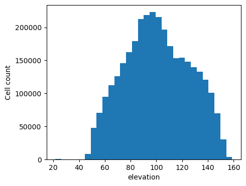
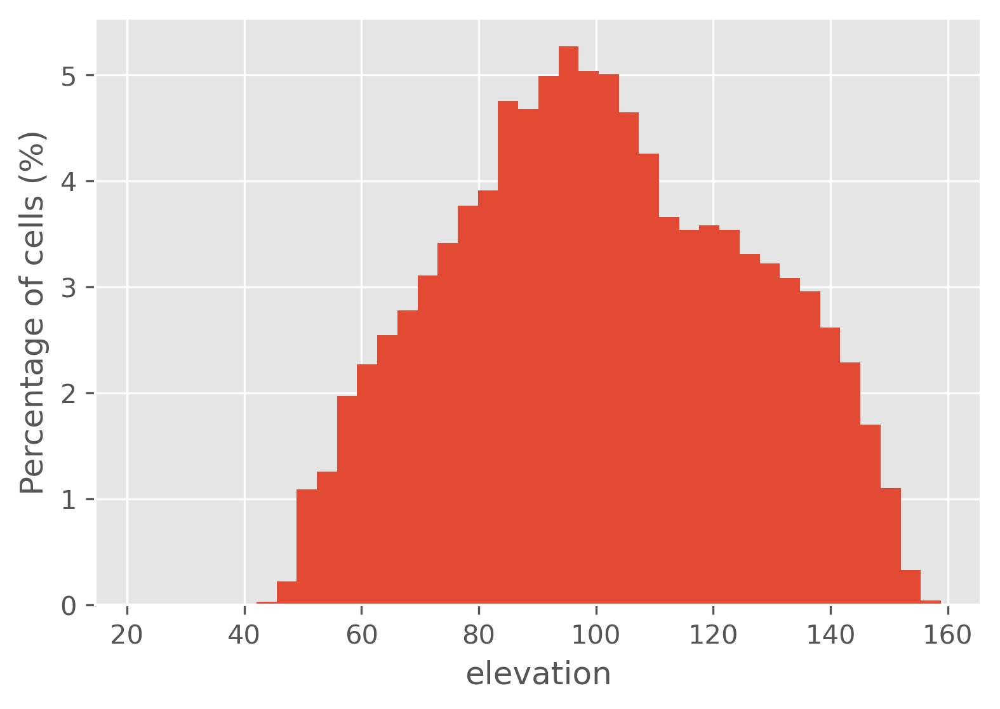
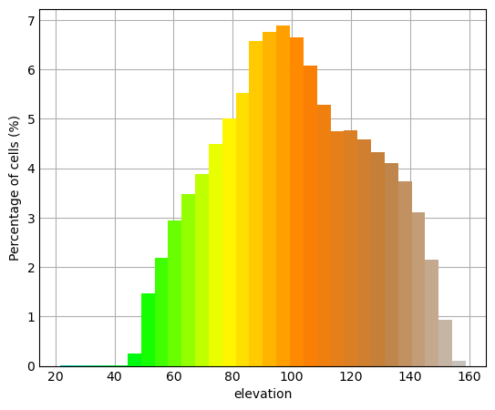

## DESCRIPTION

*r.histogram* draws a histogram of the non-NULL values in an input raster map.
The **bins** option sets the number of equal-width intervals. The height of
each bar is the number of raster cells in that interval. Set
**frequency=percent** to show each bin as a percentage of all non-NULL cells
instead; the percentages across all bins sum to 100.

The histogram is computed with *r.stats*. Only the aggregated count for each
bin is passed to Python, so memory use does not depend on the number of cells in
the raster. Integer rasters are converted to a temporary floating-point raster
to ensure that values are grouped into the requested number of equal-width
bins instead of being reported as individual categories.

By default, the active Matplotlib style determines the bar color. A single
**color** can be set using a color name, hexadecimal value, or `R:G:B` triplet.
With the **-c** flag, every bar is assigned the input raster's color at the
midpoint of that bin. This mirrors both continuous color ramps and discrete
color tables. If both **-c** and **color** are given, **-c** takes precedence.
The **border_color**, **border_width**, and relative bar width (**rwidth**)
options control the remaining bar appearance.

The histogram can be drawn horizontally (**-h**), with grid lines along the
count axis (**-g**), rotated value-axis labels (**rotate_labels**), an optional
**title**, custom **x_label** and **y_label** axis labels, and limited
value-axis bounds (**axis_limits**). A Matplotlib [style
sheet](https://matplotlib.org/stable/gallery/style_sheets/style_sheets_reference.html)
can be applied with the **style** option, for example `style=ggplot`. **style**
also accepts the path to a custom
[.mplstyle file](https://matplotlib.org/stable/tutorials/introductory/customizing.html#defining-your-own-style).
The **background_color** option sets the background of both the figure and the
plotting area. It accepts color names, hexadecimal values, and `R:G:B`
triplets. Set `background_color=transparent` to create a transparent
background in output formats that support transparency, such as PNG.

By default, the plot is displayed on screen. If **output** is given, the plot
is written to that file. The file format is determined from its extension. The
size (**plot_dimensions**, in inches), resolution (**dpi**), and **fontsize**
can be set as well.

## NOTES

The histogram is computed over the current computational region and respects
an active raster mask. When the current region, mask, or integer data type
requires it, the module creates and removes a temporary floating-point raster.
It does not modify the input map.

For a constant raster, the module draws one bar centered on the single raster
value because multiple zero-width bins would overlap.

Matplotlib is required.

## EXAMPLES

The examples use the Raleigh, North Carolina sample dataset.

Draw a 40-bin histogram of the `elevation` raster:

```sh
g.region raster=elevation
r.histogram map=elevation plot_dimensions=5,4 \
  dpi=100 output=r_histogram_01.png
```



To change the appearance of the plot, apply a matplotlib style, like the ggplot style.

```sh
r.histogram map=elevation plot_dimensions=5,4 \
  dpi=100 frequency=percent style=ggplot \
  output=r_histogram_02.png
```



Draw the histogram with each bar colored from the `elevation` raster color
table and express the frequencies as percentages. We'll use 

```sh
r.histogram -c map=elevation plot_dimensions=5,4 \
  dpi=100 frequency=percent style=_mpl-gallery \
  output=r_histogram_03.png
```




Draw a horizontal histogram with a grid, a reduced relative bar width, and a
Matplotlib style:

```sh
r.histogram -hg map=elevation plot_dimensions=5,4 \
  dpi=100  rwidth=0.9 style=ggplot \
  x_label="Number of cells" y_label="Elevation (m)" \
  background_color=transparent output=r_histogram_04.png
```


## SEE ALSO

*[d.histogram](https://grass.osgeo.org/grass-stable/manuals/d.histogram.html),
[r.boxplot](https://grass.osgeo.org/grass-stable/manuals/addons/r.boxplot.html),
[r.quantile](https://grass.osgeo.org/grass-stable/manuals/r.quantile.html),
[r.stats](https://grass.osgeo.org/grass-stable/manuals/r.stats.html),
[v.histogram](https://grass.osgeo.org/grass-stable/manuals/addons/v.histogram.html)*

## AUTHOR

[Paulo van Breugel](https://ecodiv.earth), [HAS green academy](https://has.nl),
[Innovative Biomonitoring research
group](https://www.has.nl/en/research/professorships/innovative-biomonitoring-professorship/),
[Climate-robust Landscapes research
group](https://www.has.nl/en/research/professorships/climate-robust-landscapes-professorship/)
