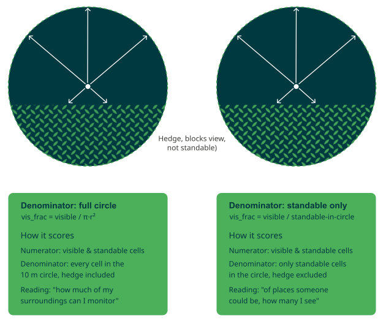

## DESCRIPTION

*v.viewshed.frac* computes, for every point in an input vector map, the fraction
of its surrounding area that is visible to an observer standing at that point.
Two fractions can be produced, written as new columns on the input point map:

- **column_circle** — visible cells ÷ all cells within *max_distance*.
  Obstructions (e.g. hedges, walls) that occupy part of the circle lower the
  score even though nobody could stand inside them. This is the appropriate
  denominator when the question is *"how much of my surroundings can I
  monitor?"*
- **column_standable** — visible cells ÷ standable cells within *max_distance*.
  Only cells where a person could actually be standing count in the denominator.
  Useful when the question is *"of the places someone could be, how many can I
  see?"*



The module is aimed at producing an overview of **relative visibility along
paths or across park/plaza networks**, e.g., a social safety analysis where one
wants to highlight stretches of a footpath with very low visibility of the
surroundings. Sampling a path at regular intervals (e.g. with *v.to.points*) and
running *v.viewshed.frac* on the resulting points yields a continuous visibility
profile along the route. Other applications include comparing candidate bench or
camera locations, evaluating the effect of proposed vegetation management, and
computing openness indicators for urban-design studies.

For each observer point the module:

1. Sets a local computational region of *max_distance* around the point, snapped
   to the *surface* raster grid.
2. Runs *r.viewshed* on the user-supplied blocking surface with the *-b* flag
   (binary output).
3. Intersects the visible cells with the required *standable* mask.
4. Divides by the chosen denominator and writes the result to the named
   attribute column(s).

## NOTES

### Blocking surface

The *surface* raster must represent the elevation that blocks sightlines at eye
level. A typical construction is

```sh
r.mapcalc "viewshed_surface = dtm + if(isnull(chm), 0, chm)"
```

where *chm* is a canopy-height or obstacle-height raster limited to the height
range below eye level (e.g. vegetation up to 2 m). Tall canopies whose crowns
start above eye level do not block person-to-person sightlines and should
therefore be absent from *chm*.

### Standable mask

The *standable* raster defines which cells may count as valid target locations.
Null and zero cells are treated as excluded; all other values are treated as
standable. A typical construction is

```sh
r.mapcalc "standable = if(isnull(chm) || chm <= 0.2, 1, null())"
```

### Per-point elevations

*observer_elevation* and *target_elevation* accept either a scalar (applied to
all points) or the name of a numeric column in the input map. This allows eye
heights to vary per observer, useful when points represent different sensors,
camera heights, or seated versus standing people.

### Limitations

- Non-square cells (different N-S and E-W resolutions) are not supported.
- *r.viewshed* itself is not parallelised; parallelism here means running
  multiple *r.viewshed* calls concurrently, one per observer.
- Attribute writes happen serially after all workers finish, to avoid SQLite
  contention.

## EXAMPLES

### Visibility along a footpath

Sample a path every 2 m, then compute the full-circle visibility fraction within
a 10 m radius:

```sh
g.region raster=viewshed_surface
v.to.points input=footpath output=footpath_pts dmax=2
v.viewshed.frac input=footpath_pts \
    surface=viewshed_surface standable=standable \
    column_circle=vis_frac \
    max_distance=10 observer_elevation=1.7 target_elevation=1.7 \
    memory=8000 nprocs=8
```

The resulting *vis_frac* column can be used to colour the points or interpolated
along the path to produce a continuous "social safety" profile.

### Both metrics, per-point eye height

```sh
v.viewshed.frac input=survey_points \
    surface=viewshed_surface standable=standable \
    column_circle=vis_frac column_standable=vis_frac_std \
    observer_elevation=eye_h target_elevation=1.7 \
    max_distance=15 nprocs=8
```

Here *eye_h* is a numeric column on *survey_points* containing each respondent's
eye height in metres.

## SEE ALSO

*[r.viewshed](https://grass.osgeo.org/grass-stable/manuals/r.viewshed.html),
[r.viewshed.exposure](https://grass.osgeo.org/grass-stable/manuals/addons/r.viewshed.exposure.html),
[r.viewshed.cva](https://grass.osgeo.org/grass-stable/manuals/addons/r.viewshed.cva.html)*

## AUTHOR

[Paulo van Breugel](https://ecodiv.earth), [HAS green academy](https://has.nl), [Innovative Biomonitoring research group](https://www.has.nl/en/research/professorships/innovative-bio-monitoring-professorship/), [Climate-robust Landscapes research group](https://www.has.nl/en/research/professorships/climate-robust-landscapes-professorship/)